# Clean Architecture Template

A pragmatic Clean Architecture starter for **.NET 10**. Batteries included, opinionated where it matters, and easy to extend.

> **Author:** Ramazan Abdullah


---

## Table of contents

1. [What's included](#whats-included)
2. [Quick start](#quick-start)
3. [Architecture overview](#architecture-overview)
4. [Solution structure](#solution-structure)
5. [Layers in detail](#layers-in-detail)
6. [Request lifecycle](#request-lifecycle)
7. [CQRS and the decorator pipeline](#cqrs-and-the-decorator-pipeline)
8. [Error handling: Result pattern → ProblemDetails](#error-handling-result-pattern--problemdetails)
9. [Domain events](#domain-events)
10. [Authentication and authorization](#authentication-and-authorization)
11. [Data model and persistence](#data-model-and-persistence)
12. [Caching](#caching)
13. [Cross-cutting web concerns](#cross-cutting-web-concerns)
14. [Observability](#observability)
15. [API reference](#api-reference)
16. [Configuration reference](#configuration-reference)
17. [Runtime topology (Docker)](#runtime-topology-docker)
18. [Testing strategy](#testing-strategy)
19. [Build, CI and code quality](#build-ci-and-code-quality)
20. [Adding a new feature](#adding-a-new-feature)
21. [Extension points and production checklist](#extension-points-and-production-checklist)
22. [Targeting .NET 8 / .NET 9](#targeting-net-8--net-9)
23. [Author](#author)

---

## What's included

| Area | What you get |
| --- | --- |
| **SharedKernel** | `Result` / `Result<T>`, `Error` / `ErrorType`, `ValidationError`, `Entity` (with domain-event buffer), `IDomainEvent`, `IDomainEventHandler<T>`, `IDateTimeProvider` |
| **Domain** | `User`, `RefreshToken`, `TodoItem` entities, domain events, error catalogs (`UserErrors`, `TodoItemErrors`) |
| **Application** | MediatR-free CQRS (`ICommand`, `IQuery`), vertical-slice use cases for Todos and Users, FluentValidation, validation + logging decorators (Scrutor), `PagedList<T>`, HybridCache usage |
| **Infrastructure** | EF Core + PostgreSQL (snake_case, migrations), JWT + **rotating refresh tokens**, permission-based authorization, domain-event dispatcher, HybridCache, health checks, `LoggingEmailSender` |
| **Web.Api** | Minimal-API endpoints (auto-discovered `IEndpoint`), Scalar/OpenAPI with JWT, **rate limiting**, **security headers**, **CORS**, **idempotency filter**, global exception handling, `ProblemDetails`, Serilog, **OpenTelemetry** |
| **Observability** | Grafana + Loki + Tempo + Prometheus in one container (`grafana/otel-lgtm`), fed over OTLP |
| **Tests** | Architecture tests (NetArchTest), unit tests (xUnit + NSubstitute + EF InMemory), integration tests (**Testcontainers** PostgreSQL) |
| **Tooling** | Central package management, analyzer-strict build (`TreatWarningsAsErrors` + SonarAnalyzer), GitHub Actions CI, Dependabot, Claude Code skills |

---

## Quick start

### Prerequisites

- [.NET 10 SDK](https://dotnet.microsoft.com/download)
- [Docker Desktop](https://www.docker.com/products/docker-desktop/) (for PostgreSQL, the observability stack, and integration tests)

### Option A — run everything in Docker

```bash
docker compose up -d --build
```

| Service | URL |
| --- | --- |
| API | http://localhost:5000 |
| API reference (Scalar) | http://localhost:5000/scalar/v1 |
| Health check | http://localhost:5000/health |
| Grafana (logs / traces / metrics) | http://localhost:3000 |
| PostgreSQL | `localhost:5432` (user `postgres`, password `postgres`) |

In `Development`, EF Core migrations are applied automatically on startup.

### Option B — infrastructure in Docker, API on the host (best for debugging)

```bash
docker compose up -d postgres observability
```

The Development connection string targets the Docker hostname `postgres`, so point it at `localhost` when running on the host:

```bash
# bash
export ConnectionStrings__Database="Host=localhost;Port=5432;Database=clean-architecture;Username=postgres;Password=postgres;Include Error Detail=true"
export OTEL_EXPORTER_OTLP_ENDPOINT="http://localhost:4317"
export Serilog__WriteTo__1__Args__endpoint="http://localhost:4317"
dotnet run --project src/Web.Api --launch-profile http
```

```powershell
# PowerShell
$env:ConnectionStrings__Database = "Host=localhost;Port=5432;Database=clean-architecture;Username=postgres;Password=postgres;Include Error Detail=true"
$env:OTEL_EXPORTER_OTLP_ENDPOINT = "http://localhost:4317"
$env:Serilog__WriteTo__1__Args__endpoint = "http://localhost:4317"
dotnet run --project src/Web.Api --launch-profile http
```

The browser opens on the Scalar API reference (`/scalar/v1`).

### Try it

```bash
# 1. Register
curl -X POST http://localhost:5000/users/register -H "Content-Type: application/json" \
  -d '{"email":"jane@example.com","firstName":"Jane","lastName":"Doe","password":"Password123"}'

# 2. Login -> { accessToken, refreshToken }
curl -X POST http://localhost:5000/users/login -H "Content-Type: application/json" \
  -d '{"email":"jane@example.com","password":"Password123"}'

# 3. Call a protected endpoint
curl http://localhost:5000/todos/{id} -H "Authorization: Bearer <accessToken>"
```

### Run the tests

```bash
dotnet test CleanArchitecture.slnx   # Docker must be running (Testcontainers)
```

---

## Architecture overview

The solution follows **Clean Architecture**: source-code dependencies point **inward only**. The business core (Domain + SharedKernel) knows nothing about databases, HTTP, or frameworks; outer layers plug into abstractions defined by inner layers.

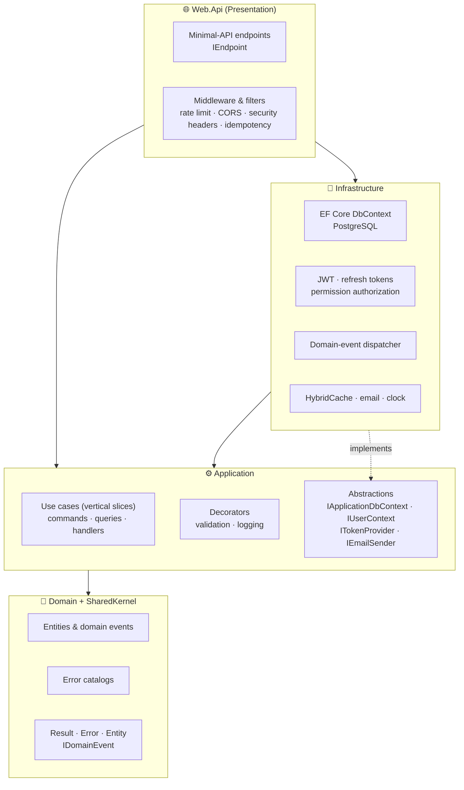

### Project reference graph

This is the actual `<ProjectReference>` graph — enforced at build time by the compiler and at test time by `ArchitectureTests`.

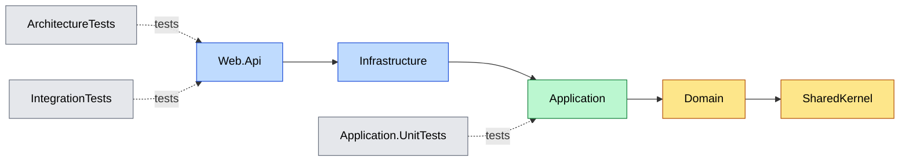

### Dependency rules

| Layer | May depend on | Must **not** depend on |
| --- | --- | --- |
| SharedKernel | — | everything |
| Domain | SharedKernel | Application, Infrastructure, Web.Api, EF Core |
| Application | Domain, SharedKernel | Infrastructure, Web.Api |
| Infrastructure | Application (and transitively the core) | Web.Api |
| Web.Api | Infrastructure, Application | — (composition root) |

---

## Solution structure

```text
CleanArchitecture.slnx
├── Directory.Build.props          # TFM, nullable, analyzers, warnings-as-errors, assembly metadata
├── Directory.Packages.props       # Central package versions
├── docker-compose.yml             # web-api + postgres + observability (otel-lgtm)
├── docker-compose.override.yml    # Development env vars / ports / user-secrets mounts
├── .github/
│   ├── workflows/build.yml        # Restore → Build → Test → Publish
│   └── dependabot.yml
├── .claude/skills/                # Claude Code skills: add-feature, add-entity, ...
├── src/
│   ├── SharedKernel/              # Result, Error, Entity, IDomainEvent, IDateTimeProvider
│   ├── Domain/
│   │   ├── Todos/                 # TodoItem, Priority, TodoItem*DomainEvent, TodoItemErrors
│   │   └── Users/                 # User, RefreshToken, UserRegisteredDomainEvent, UserErrors
│   ├── Application/
│   │   ├── Abstractions/
│   │   │   ├── Authentication/    # IPasswordHasher, ITokenProvider, IUserContext
│   │   │   ├── Behaviors/         # ValidationDecorator, LoggingDecorator
│   │   │   ├── Data/              # IApplicationDbContext
│   │   │   ├── Messaging/         # ICommand, ICommandHandler, IQuery, IQueryHandler
│   │   │   ├── Notifications/     # IEmailSender
│   │   │   └── Pagination/        # PagedList<T>
│   │   ├── Todos/{Complete,Copy,Create,Delete,Get,GetById,Update}/
│   │   └── Users/{GetByEmail,GetById,Login,Refresh,Register}/
│   ├── Infrastructure/
│   │   ├── Authentication/        # TokenProvider, PasswordHasher, UserContext
│   │   ├── Authorization/         # Permission policy provider + handler
│   │   ├── Database/              # ApplicationDbContext, Migrations, Schemas
│   │   ├── DomainEvents/          # DomainEventsDispatcher
│   │   ├── Notifications/         # LoggingEmailSender
│   │   ├── Time/                  # DateTimeProvider
│   │   ├── Todos/ Users/          # IEntityTypeConfiguration<T> per feature
│   │   └── DependencyInjection.cs
│   └── Web.Api/
│       ├── Endpoints/{Todos,Users}/   # One class per endpoint (IEndpoint)
│       ├── Extensions/            # OpenAPI, CORS, rate limiting, OTel, migrations, Result.Match
│       ├── Infrastructure/        # CustomResults, GlobalExceptionHandler, IdempotencyFilter
│       ├── Middleware/            # SecurityHeaders, RequestContextLogging
│       └── Program.cs             # Composition root
└── tests/
    ├── ArchitectureTests/         # Layer dependency rules (NetArchTest)
    ├── Application.UnitTests/     # Handlers & validators (NSubstitute + EF InMemory)
    └── IntegrationTests/          # Full HTTP stack against real PostgreSQL (Testcontainers)
```

---

## Layers in detail

### SharedKernel

Framework-free building blocks shared by every layer.

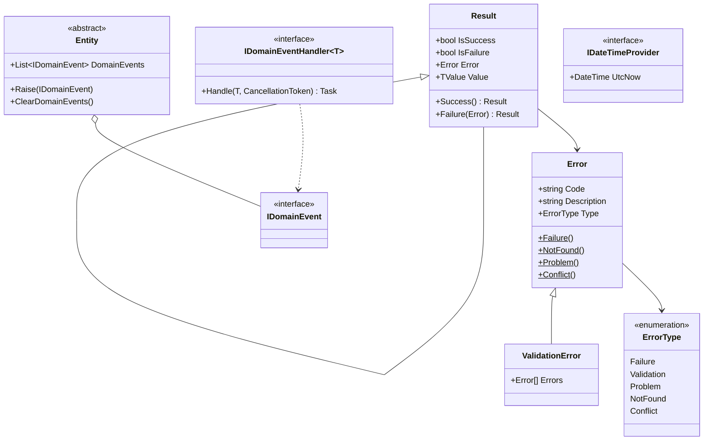

### Domain

Plain entities that derive from `Entity` and raise domain events. Error catalogs live next to the entity and follow the `"{FeaturePlural}.{Reason}"` code convention:

```csharp
public static class UserErrors
{
    public static Error NotFound(Guid userId) => Error.NotFound(
        "Users.NotFound", $"The user with the Id = '{userId}' was not found");

    public static readonly Error EmailNotUnique = Error.Conflict(
        "Users.EmailNotUnique", "The provided email is not unique");
}
```

| Feature | Entities | Domain events |
| --- | --- | --- |
| Users | `User`, `RefreshToken` | `UserRegisteredDomainEvent` |
| Todos | `TodoItem`, `Priority` enum | `TodoItemCreated`, `TodoItemUpdated`, `TodoItemCompleted`, `TodoItemDeleted` |

### Application

Use cases organised as **vertical slices** — each folder contains everything for one operation:

```text
Application/Todos/Create/
├── CreateTodoCommand.cs            # record : ICommand<Guid>
├── CreateTodoCommandValidator.cs   # AbstractValidator<CreateTodoCommand>
└── CreateTodoCommandHandler.cs     # internal sealed, primary constructor
```

Handlers depend only on abstractions (`IApplicationDbContext`, `IUserContext`, `IDateTimeProvider`, `HybridCache`, …) and return `Result` rather than throwing.

### Infrastructure

Implements every Application abstraction. Registration happens in `Infrastructure/DependencyInjection.cs`:

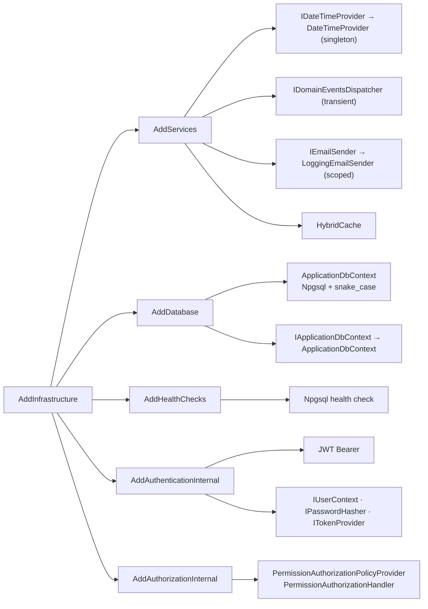

### Web.Api

The composition root. Each endpoint is a small class implementing `IEndpoint`; they are discovered by reflection (`AddEndpoints(Assembly)`) and mapped with `app.MapEndpoints()`.

```csharp
internal sealed class Create : IEndpoint
{
    public void MapEndpoint(IEndpointRouteBuilder app)
    {
        app.MapPost("todos", async (Request request, ICommandHandler<CreateTodoCommand, Guid> handler, CancellationToken ct) =>
        {
            Result<Guid> result = await handler.Handle(new CreateTodoCommand { /* ... */ }, ct);
            return result.Match(Results.Ok, CustomResults.Problem);
        })
        .WithTags(Tags.Todos)
        .WithIdempotency()
        .RequireAuthorization();
    }
}
```

---

## Request lifecycle

The full path of an authenticated `POST /todos` request, in the order components execute (see `Program.cs`):

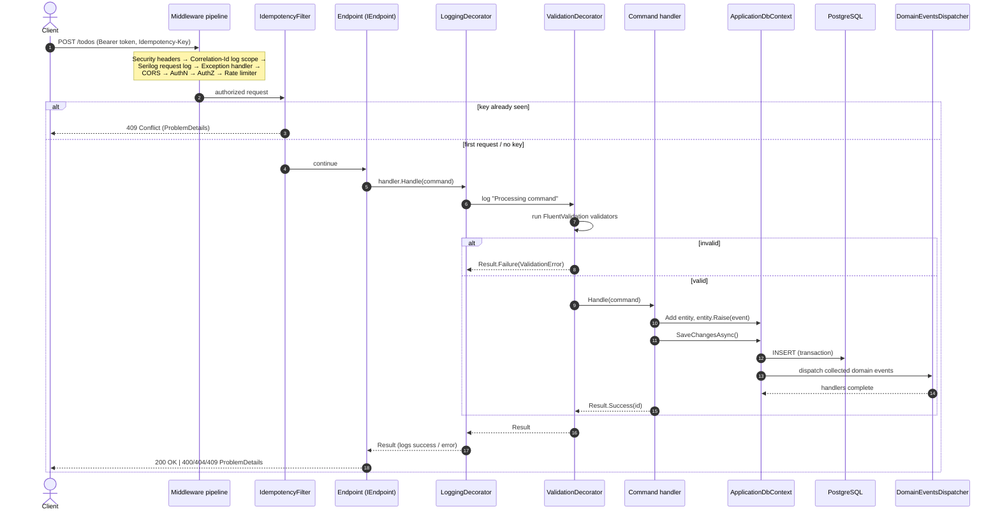

### Middleware order

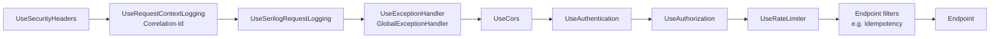

---

## CQRS and the decorator pipeline

No MediatR. Handlers are resolved **directly** from DI by their interface, and Scrutor wraps them in decorators at registration time:

```csharp
public interface ICommand;
public interface ICommand<TResponse>;
public interface IQuery<TResponse>;

public interface ICommandHandler<in TCommand> where TCommand : ICommand
{ Task<Result> Handle(TCommand command, CancellationToken cancellationToken); }

public interface ICommandHandler<in TCommand, TResponse> where TCommand : ICommand<TResponse>
{ Task<Result<TResponse>> Handle(TCommand command, CancellationToken cancellationToken); }

public interface IQueryHandler<in TQuery, TResponse> where TQuery : IQuery<TResponse>
{ Task<Result<TResponse>> Handle(TQuery query, CancellationToken cancellationToken); }
```

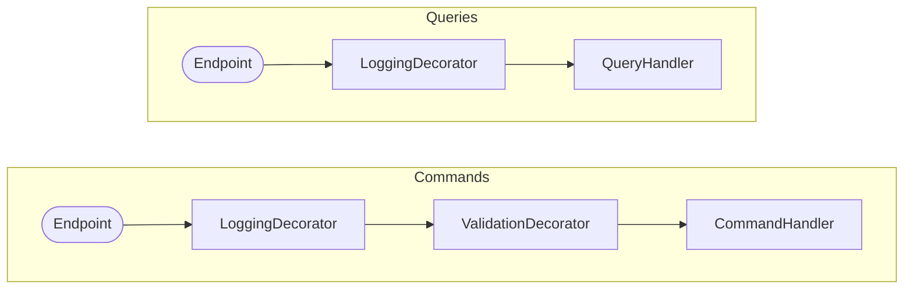

| Decorator | Applies to | Behaviour |
| --- | --- | --- |
| `LoggingDecorator` | commands + queries | Logs `Processing …` / `Completed …`; on failure pushes the `Error` into the Serilog `LogContext` and logs at Error level |
| `ValidationDecorator` | commands | Runs every `IValidator<TCommand>` in parallel; short-circuits with a `ValidationError` (→ HTTP 400) |

Registration (`Application/DependencyInjection.cs`):

```csharp
services.Scan(scan => scan.FromAssembliesOf(typeof(DependencyInjection))
    .AddClasses(c => c.AssignableTo(typeof(IQueryHandler<,>)), publicOnly: false).AsImplementedInterfaces().WithScopedLifetime()
    .AddClasses(c => c.AssignableTo(typeof(ICommandHandler<>)), publicOnly: false).AsImplementedInterfaces().WithScopedLifetime()
    .AddClasses(c => c.AssignableTo(typeof(ICommandHandler<,>)), publicOnly: false).AsImplementedInterfaces().WithScopedLifetime());

services.Decorate(typeof(ICommandHandler<,>), typeof(ValidationDecorator.CommandHandler<,>));
services.Decorate(typeof(ICommandHandler<>),  typeof(ValidationDecorator.CommandBaseHandler<>));
services.Decorate(typeof(IQueryHandler<,>),   typeof(LoggingDecorator.QueryHandler<,>));
services.Decorate(typeof(ICommandHandler<,>), typeof(LoggingDecorator.CommandHandler<,>));
services.Decorate(typeof(ICommandHandler<>),  typeof(LoggingDecorator.CommandBaseHandler<>));
```

> The last `Decorate` call is the outermost wrapper, so logging surrounds validation.

---

## Error handling: Result pattern → ProblemDetails

Expected failures are **values**, not exceptions. Endpoints translate them with one line:

```csharp
return result.Match(Results.Ok, CustomResults.Problem);
```

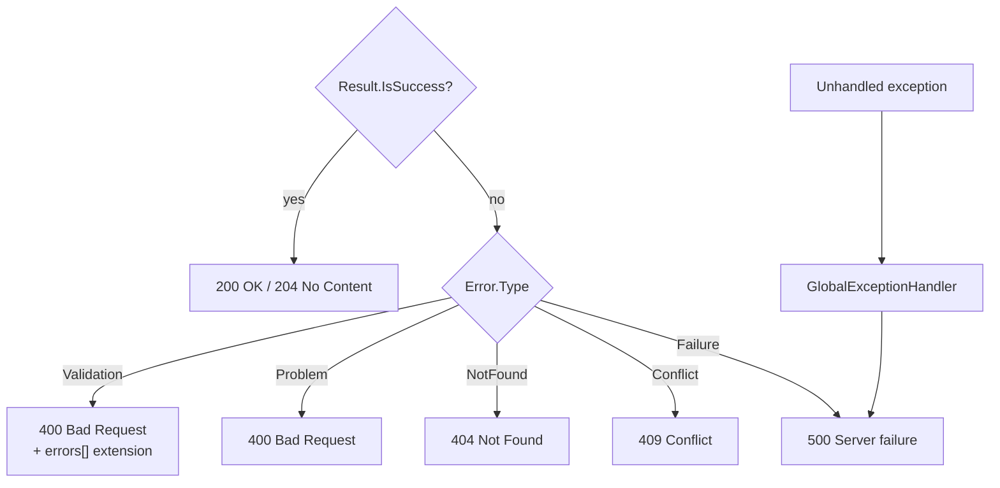

| `ErrorType` | HTTP status | `title` | RFC `type` link |
| --- | --- | --- | --- |
| `Validation` | 400 | error code | RFC 7231 §6.5.1 |
| `Problem` | 400 | error code | RFC 7231 §6.5.1 |
| `NotFound` | 404 | error code | RFC 7231 §6.5.4 |
| `Conflict` | 409 | error code | RFC 7231 §6.5.8 |
| `Failure` | 500 | `Server failure` | RFC 7231 §6.6.1 |

Example validation response:

```json
{
  "type": "https://tools.ietf.org/html/rfc7231#section-6.5.1",
  "title": "Validation.General",
  "status": 400,
  "detail": "One or more validation errors occurred",
  "errors": [
    { "code": "NotEmptyValidator", "description": "'Email' must not be empty.", "type": 2 }
  ]
}
```

---

## Domain events

Entities buffer events with `Raise(...)`. `ApplicationDbContext.SaveChangesAsync` collects them from the change tracker, commits the transaction, then dispatches them — i.e. **eventual consistency**: handlers run after the data is persisted, each in its own DI scope.

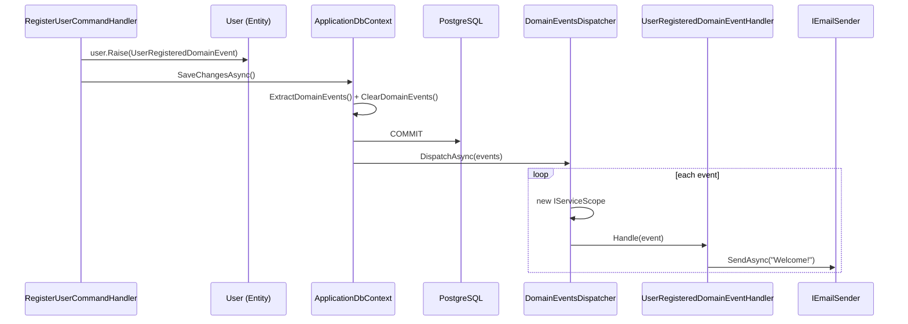

- Handlers implement `IDomainEventHandler<TEvent>` and are auto-registered by Scrutor.
- The dispatcher caches closed generic handler/wrapper types in `ConcurrentDictionary` to avoid repeated reflection.
- Need atomic, retryable side-effects? Replace post-commit dispatch with an **outbox** table written in the same transaction.

---

## Authentication and authorization

### Tokens

| Token | Format | Lifetime | Storage |
| --- | --- | --- | --- |
| Access token | JWT (HS256) with `sub` + `email` claims | `Jwt:ExpirationInMinutes` (60 in Development) | client only |
| Refresh token | 32 random bytes, Base64 | 7 days | `refresh_tokens` table (unique index on `token`) |

JWT validation uses `ClockSkew = TimeSpan.Zero`, so tokens expire exactly on time.

### Login and refresh-token rotation

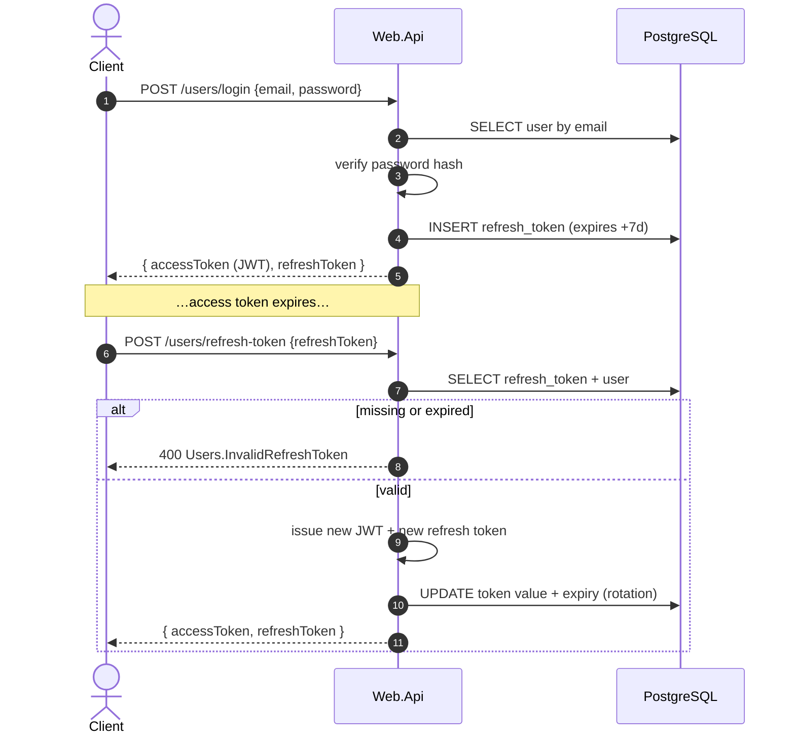

Rotation means a stolen refresh token can be used **at most once** — the legitimate client's next refresh fails and the theft becomes visible.

### Permission-based authorization

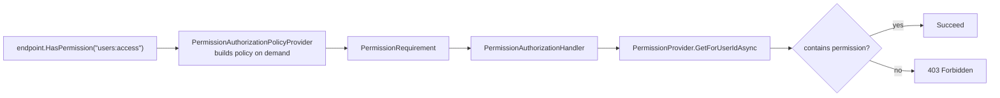

> ⚠️ **Template default:** `PermissionAuthorizationHandler` currently **grants every permission to any authenticated user**, and `PermissionProvider` returns an empty set. Implement `PermissionProvider.GetForUserIdAsync` (e.g. roles → permissions tables, cached with HybridCache) and remove the shortcut before production.

### Resource ownership

Handlers acting on user-owned data compare the resource owner with `IUserContext.UserId` (or filter queries by it) and return `UserErrors.Unauthorized()` on mismatch.

---

## Data model and persistence

- **Provider:** PostgreSQL via `Npgsql.EntityFrameworkCore.PostgreSQL`
- **Naming:** `EFCore.NamingConventions` → `snake_case` tables and columns
- **Schema:** `public` (`Schemas.Default`), migrations history in the same schema
- **Configurations:** `IEntityTypeConfiguration<T>` under `Infrastructure/{Feature}/`, auto-applied with `ApplyConfigurationsFromAssembly`
- **Relationships:** FK ids with shadow relationships (`HasOne<User>().WithMany().HasForeignKey(...)`), no navigation collections
- **Migrations:** `Infrastructure/Database/Migrations`, applied automatically in Development (`app.ApplyMigrations()`)

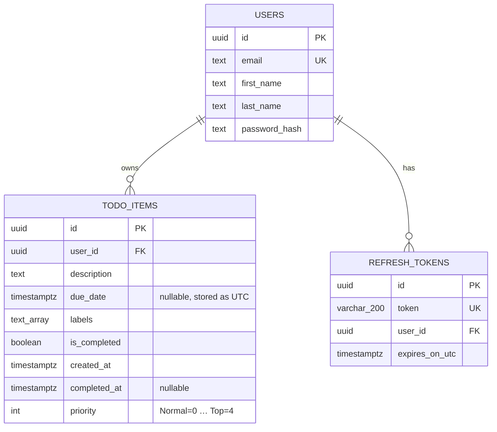

### Working with migrations

```bash
dotnet ef migrations add <Name> \
  --project src/Infrastructure \
  --startup-project src/Web.Api \
  --output-dir Database/Migrations

dotnet ef database update --project src/Infrastructure --startup-project src/Web.Api
```

### Paging, search and sort

List queries return `PagedList<T>`:

```json
{ "items": [ ... ], "page": 1, "pageSize": 10, "totalCount": 42, "hasNextPage": true, "hasPreviousPage": false }
```

`GET /todos?userId=…&search=milk&sortColumn=dueDate&sortOrder=desc&page=2&pageSize=20`

---

## Caching

[`HybridCache`](https://learn.microsoft.com/aspnet/core/performance/caching/hybrid) gives an in-memory L1 cache with optional distributed L2 (add Redis to enable it) and built-in stampede protection.

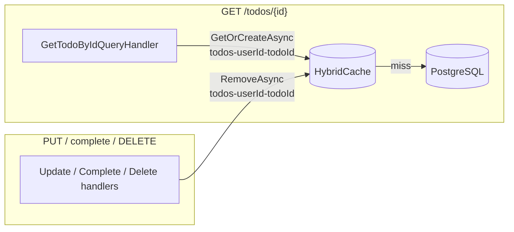

- Keys come from per-feature helpers (`TodoCacheKeys.ById(userId, todoItemId)`), so reads and invalidations can never drift apart.
- Keys include the user id, so one user can never be served another user's cached item.

---

## Cross-cutting web concerns

| Concern | Implementation | Notes |
| --- | --- | --- |
| **Rate limiting** | `RateLimitingExtensions` | Global fixed window partitioned by user name or client IP; stricter `authentication` policy on `register`, `login`, `refresh-token`. Rejections return **429**. |
| **Idempotency** | `IdempotencyFilter` via `.WithIdempotency()` | Opt-in per endpoint. First request with an `Idempotency-Key` header is processed; repeats within **1 hour** return **409 Conflict**. Requests without the header are unaffected. |
| **Security headers** | `SecurityHeadersMiddleware` | `X-Content-Type-Options: nosniff`, `X-Frame-Options: DENY`, `Referrer-Policy: no-referrer`, `X-Permitted-Cross-Domain-Policies: none`, `Cross-Origin-Opener-Policy: same-origin` |
| **CORS** | `AddCorsInternal` | Default policy from `Cors:AllowedOrigins`; any header/method, credentials allowed. Empty list = no cross-origin access. |
| **Correlation id** | `RequestContextLoggingMiddleware` | Reads `Correlation-Id` header (falls back to `TraceIdentifier`) and pushes it onto every log event. |
| **Exceptions** | `GlobalExceptionHandler` | Logs and returns a generic 500 `ProblemDetails` — no stack traces leak to clients. |
| **Health** | `MapHealthChecks("health")` | PostgreSQL connectivity, HealthChecks-UI JSON format. |
| **API docs** | `AddOpenApiWithAuth` + Scalar | Development only, at `/scalar/v1`; Bearer scheme added so you can authorize in the UI. |

---

## Observability

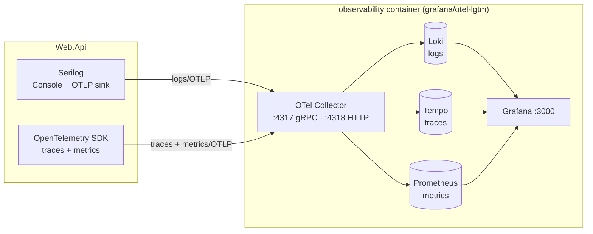

| Signal | Sources |
| --- | --- |
| **Traces** | ASP.NET Core, `HttpClient`, Npgsql (SQL spans) |
| **Metrics** | ASP.NET Core, `HttpClient`, .NET runtime (GC, thread pool, …) |
| **Logs** | Serilog, enriched with `FromLogContext`, `WithMachineName`, `WithThreadId`, plus `CorrelationId` and handler `Error` properties |

The OTLP exporter is enabled only when `OTEL_EXPORTER_OTLP_ENDPOINT` is set, so the app runs fine without a collector. Any OTLP backend works (Grafana stack, .NET Aspire dashboard, Jaeger, Honeycomb, …).

---

## API reference

| Method | Route | Auth | Extras | Description |
| --- | --- | --- | --- | --- |
| `POST` | `/users/register` | anonymous | rate limit: `authentication` | Create an account; raises `UserRegisteredDomainEvent` |
| `POST` | `/users/login` | anonymous | rate limit: `authentication` | Returns access + refresh tokens |
| `POST` | `/users/refresh-token` | anonymous | rate limit: `authentication` | Rotates the refresh token |
| `GET` | `/users/{userId}` | permission `users:access` | | Get a user |
| `GET` | `/todos` | bearer | search · sort · paging | List todos (`PagedList<TodoResponse>`) |
| `GET` | `/todos/{id}` | bearer | HybridCache | Get one todo |
| `POST` | `/todos` | bearer | `Idempotency-Key` | Create a todo |
| `PUT` | `/todos/{id}` | bearer | cache invalidation | Update description |
| `PUT` | `/todos/{id}/complete` | bearer | cache invalidation | Mark completed |
| `POST` | `/todos/{todoId}/copy` | bearer | | Duplicate a todo |
| `DELETE` | `/todos/{id}` | bearer | cache invalidation | Delete a todo |
| `GET` | `/health` | anonymous | | Health report |

---

## Configuration reference

All settings use standard ASP.NET Core configuration, so every key can be overridden with an environment variable using `__` as the separator (e.g. `Jwt__Secret`).

### `appsettings.json`

```jsonc
{
  "AllowedHosts": "*",
  "ConnectionStrings": {
    "Database": ""                       // PostgreSQL connection string
  },
  "Jwt": {
    "Secret": "",                        // HS256 signing key (≥ 32 chars) – use user-secrets / a vault
    "Issuer": "",
    "Audience": "",
    "ExpirationInMinutes": 0             // access-token lifetime
  },
  "Cors": {
    "AllowedOrigins": []                 // e.g. ["https://app.example.com"]
  },
  "RateLimiting": {
    "Global":         { "PermitLimit": 100, "WindowInSeconds": 60 },
    "Authentication": { "PermitLimit": 10,  "WindowInSeconds": 60 }
  }
}
```

### Settings table

| Key | Default (Development) | Purpose |
| --- | --- | --- |
| `ConnectionStrings:Database` | `Host=postgres;Port=5432;Database=clean-architecture;Username=postgres;Password=postgres` | EF Core + health check |
| `Jwt:Secret` | dev-only placeholder | Token signing key |
| `Jwt:Issuer` / `Jwt:Audience` | `clean-architecture` / `developers` | Token validation |
| `Jwt:ExpirationInMinutes` | `60` | Access-token lifetime |
| `Cors:AllowedOrigins` | `[]` | Allowed browser origins |
| `RateLimiting:Global:*` | `100` per `60`s | Per user/IP limit for all endpoints |
| `RateLimiting:Authentication:*` | `10` per `60`s | Login/register/refresh limit |
| `Serilog:*` | Console + OTLP (`http://observability:4317`) | Logging sinks, levels, enrichers |
| `OTEL_EXPORTER_OTLP_ENDPOINT` | `http://observability:4317` (compose) | Enables OTLP export of traces + metrics |
| `ASPNETCORE_ENVIRONMENT` | `Development` | Enables Scalar + auto-migrations |

### Secrets

Never commit real secrets. For local development use user-secrets:

```bash
dotnet user-secrets init --project src/Web.Api
dotnet user-secrets set "Jwt:Secret" "<a-long-random-value>" --project src/Web.Api
```

`docker-compose.override.yml` mounts your user-secrets folder read-only into the container.

---

## Runtime topology (Docker)

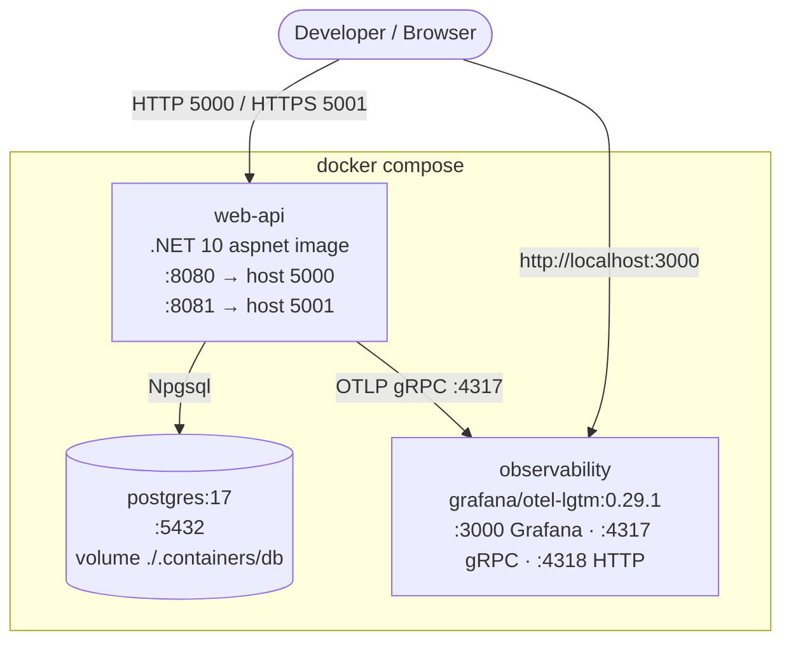

| Container | Image | Host ports | Purpose |
| --- | --- | --- | --- |
| `web-api` | built from `src/Web.Api/Dockerfile` | 5000, 5001 | The API |
| `postgres` | `postgres:17` | 5432 | Database (data persisted in `./.containers/db`) |
| `observability` | `grafana/otel-lgtm:0.29.1` | 3000, 4317, 4318 | Grafana, Loki, Tempo, Prometheus, OTel Collector |

The Dockerfile is a multi-stage build (`sdk:10.0` → `aspnet:10.0`) that restores project files first for layer caching and runs as the non-root `$APP_UID` user.

---

## Testing strategy

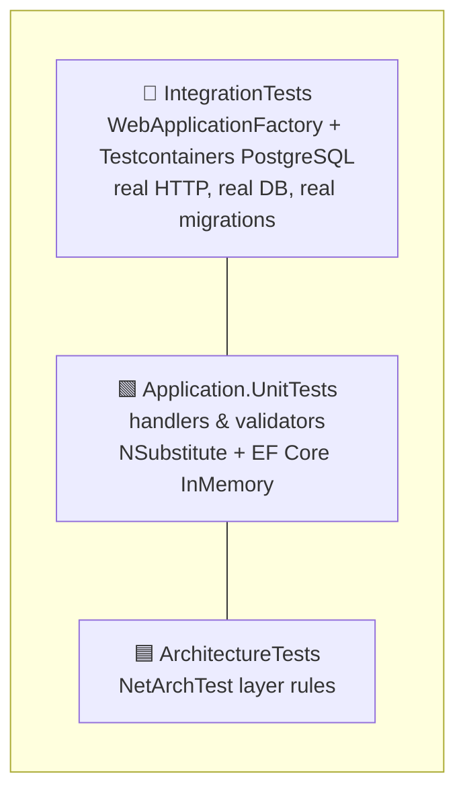

| Project | What it verifies | Tools |
| --- | --- | --- |
| `ArchitectureTests` | Domain ↛ Application/Infrastructure/Web.Api; Application ↛ Infrastructure/Web.Api; Infrastructure ↛ Web.Api | NetArchTest.Rules, Shouldly |
| `Application.UnitTests` | Handler business rules (ownership, not-found, token rotation, …) and validators | xUnit, NSubstitute, EF Core InMemory, Shouldly |
| `IntegrationTests` | End-to-end HTTP behaviour: auth (401), validation (400), happy paths, persistence | xUnit, `Microsoft.AspNetCore.Mvc.Testing`, Testcontainers.PostgreSql |

The integration test factory starts a throwaway `postgres:17` container, applies migrations, injects deterministic JWT settings, and relaxes rate limits so the suite is never throttled.

```bash
dotnet test CleanArchitecture.slnx                                   # everything
dotnet test tests/ArchitectureTests                                  # fast, no Docker
dotnet test tests/Application.UnitTests                              # fast, no Docker
dotnet test tests/IntegrationTests                                   # needs Docker
dotnet test --collect:"XPlat Code Coverage"                          # coverage (coverlet)
```

---

## Build, CI and code quality

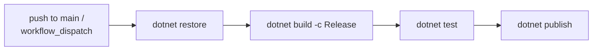

- **Analyzer-strict:** `AnalysisMode=All`, `TreatWarningsAsErrors`, `EnforceCodeStyleInBuild`, and **SonarAnalyzer.CSharp** on every project. Code must be warning-clean.
- **Central package management:** all versions live in `Directory.Packages.props`.
- **Style:** `.editorconfig` at the root; prefer collection expressions (`[.. x]`) and `ToUpperInvariant`.
- **Dependabot** keeps NuGet packages and GitHub Actions current.

---

## Adding a new feature

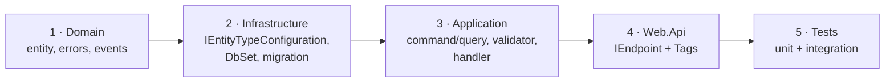

1. **Domain** — add the entity (derive from `Entity`), an `{Feature}Errors` catalog, and domain events.
2. **Infrastructure** — add `{Feature}/{Entity}Configuration.cs`, a `DbSet` on `IApplicationDbContext` + `ApplicationDbContext`, then create a migration.
3. **Application** — create `{Feature}/{UseCase}/` with the command/query record, an `AbstractValidator`, and an `internal sealed` handler. No registration needed — Scrutor finds it.
4. **Web.Api** — add an `IEndpoint` class in `Endpoints/{Feature}/`, use `result.Match(Results.Ok, CustomResults.Problem)`, tag it, and protect it with `.RequireAuthorization()` or `.HasPermission(...)`.
5. **Tests** — unit-test the handler and validator; add an integration test for the endpoint.

### Claude Code skills

This repository ships with [Claude Code skills](.claude/skills/README.md) that automate the steps above while following the conventions:

| Skill | Purpose |
| --- | --- |
| `/add-feature` | New use case end to end (command/query, validator, handler, endpoint, tests) |
| `/add-entity` | New domain entity + EF configuration + migration |
| `/add-tests` | Unit and integration tests for existing code |
| `/add-migration` | EF Core migration |
| `/add-background-job` | Hosted background job |
| `/bootstrap` | Rename the solution and strip the Todos sample |
| `/ca-review` | Review changes against the architecture conventions |

---

## Extension points and production checklist

- [ ] Implement `PermissionProvider.GetForUserIdAsync` and remove the "allow all authenticated users" shortcut in `PermissionAuthorizationHandler`.
- [ ] Replace `LoggingEmailSender` with a real `IEmailSender` (SMTP, SendGrid, …).
- [ ] Move `Jwt:Secret` and the connection string to a secret store; set `RequireHttpsMetadata = true` behind TLS.
- [ ] Configure `Cors:AllowedOrigins` for your front-end(s).
- [ ] Tune `RateLimiting` for expected traffic; consider a distributed limiter behind multiple instances.
- [ ] Add a Redis L2 for HybridCache when running more than one instance (also makes idempotency keys shared).
- [ ] Run migrations as a deployment step (or a migration bundle) instead of at startup.
- [ ] Consider an outbox for domain events that must not be lost.
- [ ] Revoke refresh tokens on logout / password change.

---

## Targeting .NET 8 / .NET 9

1. In `Directory.Build.props`, uncomment the `net8.0` or `net9.0` `<TargetFramework>` and remove `net10.0`.
2. Adjust package versions in `Directory.Packages.props` where needed.
3. Use the matching Dockerfile in `src/Web.Api/` (`Dockerfile (.NET 8)` or `Dockerfile (.NET 9)`).

---

## Author

**Ramazan Abdullah**

Feedback, issues, and pull requests are welcome.
